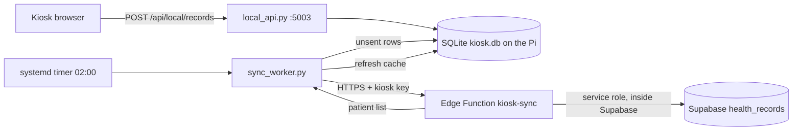

# Local database + scheduled Supabase sync

The kiosk saves every real measurement to a **SQLite database on the Raspberry Pi first**.
A scheduled job (nightly by default) then forwards unsent records to Supabase.



## Why it is built this way

| Decision | Reason |
|---|---|
| SQLite in WAL mode, `synchronous=FULL` | Survives sudden power loss, which is common on kiosks |
| Client-generated UUID per record + upsert on `client_record_id` | A retried or half-finished sync can never create duplicates |
| Edge Function, not a service-role key on the Pi | A stolen SD card must not expose your whole database |
| Per-kiosk key, only its SHA-256 hash stored in Supabase | A key can be revoked per kiosk |
| `kiosk_id` taken from the authenticated key, not the payload | A kiosk cannot write records pretending to be another kiosk |
| Patient cache pulled down at sync time | Barcode lookup works with no internet |
| Synced rows deleted locally after 30 days | Keeps patient data on the device to a minimum |
| Simulated blood pressure rejected by the API | Keeps the existing "never save fake data" rule |

## Files

| Path | Purpose |
|---|---|
| `local-db/schema.sql`, `local_db.py` | Tables, validation, queue logic |
| `local-db/local_api.py` | Local HTTP API for the browser (127.0.0.1 only) |
| `local-db/sync_worker.py` | Push records, pull patients, purge old rows |
| `supabase/migrations/20261122000000_kiosk_sync.sql` | Adds `client_record_id`, `kiosk_sync_keys` |
| `supabase/functions/kiosk-sync/index.ts` | Server side of the sync |
| `src/services/localRecords.ts` | Browser client |
| `deploy/*` | systemd units, env template, key generator |
| `local-db/tests/` | 20 automated tests |

## Setup

**1. Supabase (once)**

1. Run `supabase/migrations/20261122000000_kiosk_sync.sql` in the SQL editor.
2. Deploy the function: `supabase functions deploy kiosk-sync`.
3. Generate a key per kiosk: `python deploy/make_kiosk_key.py KIOSK-01`.
   Run the printed SQL in Supabase; keep the printed `KIOSK_SYNC_KEY` for the Pi.

**2. Raspberry Pi**

```bash
sudo useradd -r -m kiosk
sudo mkdir -p /opt/kiosk /etc/kiosk
sudo cp -r local-db /opt/kiosk/
python3 -m venv /opt/kiosk/venv
/opt/kiosk/venv/bin/pip install flask flask-cors requests

sudo cp deploy/kiosk.env.example /etc/kiosk/kiosk.env   # fill in values
sudo chmod 600 /etc/kiosk/kiosk.env
sudo chown -R kiosk /opt/kiosk

sudo cp deploy/kiosk-local-api.service deploy/kiosk-sync.service deploy/kiosk-sync.timer /etc/systemd/system/
sudo systemctl daemon-reload
sudo systemctl enable --now kiosk-local-api.service kiosk-sync.timer
```

**3. Test the sync by hand**

```bash
sudo systemctl start kiosk-sync.service
journalctl -u kiosk-sync.service -n 20
curl http://127.0.0.1:5003/api/local/sync/status
```

**4. Nightly or weekly?** Edit `OnCalendar` in `kiosk-sync.timer`
(`Sun *-*-* 02:00:00` for weekly). `Persistent=true` makes it run at boot if the kiosk was
off at the scheduled time.

## Changes needed in the existing frontend

1. Add the `/local-api` proxy shown at the top of `src/services/localRecords.ts` to `vite.config.ts`.
2. In `packages/shared/src/services/measurement.ts`, replace the Supabase
   `health_records` insert with `saveRecordLocal(...)`. Map your fields to:
   `heart_rate, spo2, temperature, height_cm, weight_kg, bmi, systolic_bp, diastolic_bp`.
3. In the kiosk scan step, try `lookupPatientLocal(id)` first and fall back to the Supabase
   lookup only if it returns `null`.
4. Staff and patient "recent measurements" views will only see a kiosk's data after the next
   sync. Show `getLocalSyncStatus().last_successful_sync` ("data as of ...") so this is not a surprise.

## Verify before relying on it

These were assumptions because I only had your audit text, not the repo or live schema:

- **Column names** in `health_records`. Edit `COLUMN_MAP` at the top of `kiosk-sync/index.ts` to match.
- **`measured_by` and `kiosk_id` types and foreign keys.** If the kiosk id in Supabase is a uuid or
  number rather than text like `KIOSK-01`, the insert will be rejected. Rejected rows are reported
  per record in `last_error` and are not lost.
- **`patients` / `profiles` columns** used by `pull_patients` (taken from `database.ts` in the audit).
- **RLS.** The function uses the service role, so it bypasses RLS. Your RLS status is still unverified (audit item).

## Known limits

- **Browser login still needs internet.** Email/password and barcode login go through Supabase Auth.
  This work makes *patient lookup and saving* offline-capable, not login.
- **Pi clock.** A Pi has no battery clock. Without internet at boot, `measured_at` can be wrong.
  Add an RTC module (e.g. DS3231) or accept that timestamps are corrected only when NTP is reachable.
- **Encrypt the SD card or disk** if possible. The DB file is `chmod 600`, but that does not stop someone
  removing the card.
- **No rate limiting** on the Edge Function beyond the key check.
- Patient names and birthdates are cached on the Pi. Confirm this is covered by your consent and
  data-privacy documentation (relevant to the Philippine Data Privacy Act).
- The Edge Function passed a Node syntax check but has **not been run against a real Supabase project**.
